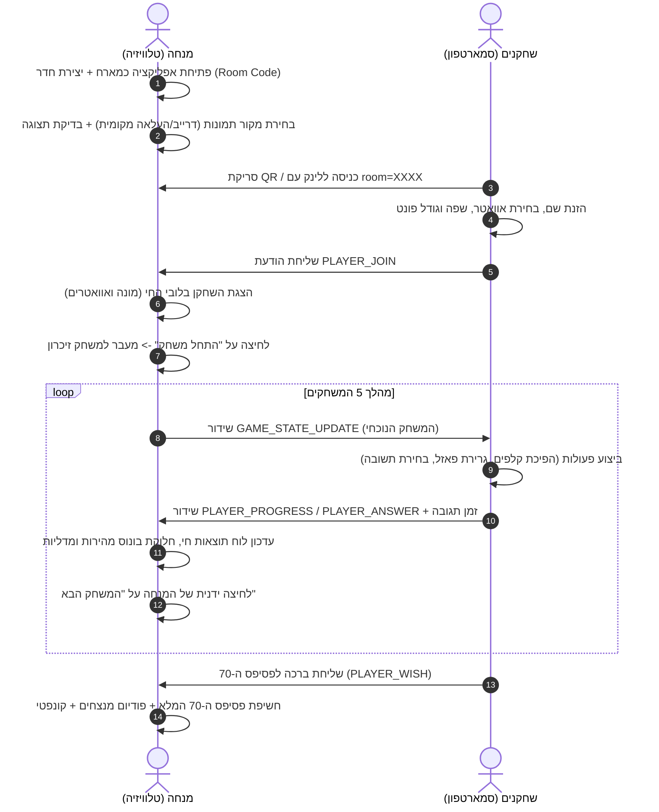

# מסמך דרישות תוכנה ומערכת (PRD / SRS)
## אפליקציית "Mom v7.0" – משחק יום הולדת 70 לאמא 🎂

---

| פרט | ערך |
| :--- | :--- |
| **שם המוצר / הפרויקט** | **Mom v7.0** (אפליקציית יום הולדת 70 לאמא) |
| **גרסת מסמך** | 1.0 (סופי ומאושר) |
| **תאריך עדכון** | נובמבר 2026 |
| **מאגר קוד (Repository)** | [GitHub - Mom70PartyApp](https://github.com/AlphaKate/Mom70PartyApp) |
| **סביבת פריסה (Live URL)** | [GitHub Pages - Mom70PartyApp](https://alphakate.github.io/Mom70PartyApp/) |
| **מטרת המסמך** | הגדרת מכלול הדרישות הפונקציונליות והלא-פונקציונליות של המערכת כבסיס ישיר לבניית **תוכנית בדיקות מקיפה (STP / STD)** |

---

## תוכן עניינים
1. [מבוא, חזון ומטרות המערכת](#1-מבוא-חזון-ומטרות-המערכת)
2. [עקרונות ברזל ואילוצי מערכת](#2-עקרונות-ברזל-ואילוצי-מערכת)
3. [ארכיטקטורה כללית ומבנה טכנולוגי](#3-ארכיטקטורה-כללית-ומבנה-טכנולוגי)
4. [פרופיל משתמשים ותרחישי שימוש (Use Cases)](#4-פרופיל-משתמשים-ותרחישי-שימוש-use-cases)
5. [דרישות פונקציונליות מפורטות (Functional Requirements)](#5-דרישות-פונקציונליות-מפורטות-functional-requirements)
   - 5.1 תשתית, נגישות, שפות ומולטימדיה (REQ-GEN)
   - 5.2 מסך בית וניווט (REQ-NAV)
   - 5.3 מסך מארח / טלוויזיה – הגדרות ולובי (REQ-HOST)
   - 5.4 כניסת שחקן ובחירת אוואטר (REQ-PLY)
   - 5.5 מודול משחק 1: משחק זיכרון משפחתי (REQ-MEM)
   - 5.6 מודול משחק 2: פאזל תמונות (REQ-PUZ)
   - 5.7 מודול משחק 3: טריוויה משפחתית (REQ-TRIV)
   - 5.8 מודול משחק 4: "מה אמא הייתה אומרת?" (REQ-QUOT)
   - 5.9 מודול משחק 5: פסיפס ברכות "70" (REQ-WISH)
   - 5.10 טקס סיום, פודיום ולוח תוצאות (REQ-FIN)
6. [דרישות לא-פונקציונליות (Non-Functional Requirements)](#6-דרישות-לא-פונקציונליות-non-functional-requirements)
   - 6.1 ביצועים וזמני תגובה (REQ-PERF)
   - 6.2 אבטחה, פרטיות ורישוי (REQ-SEC)
   - 6.3 אמינות ושרידות (REQ-REL)
   - 6.4 תאימות דפדפנים ומכשירים (REQ-COMP)
   - 6.5 שימושיות ונגישות (REQ-UX)
7. [פרק ייעודי: הצעות להרחבה ושדרוג חוויית המשתמש](#7-פרק-ייעודי-הצעות-להרחבה-ושדרוג-חוויית-המשתמש)
8. [מטריצת עקיבות ומיפוי לבדיקות (Traceability Matrix for STP/STD)](#8-מטריצת-עקיבות-ומיפוי-לבדיקות-traceability-matrix-for-stpstd)

---

## 1. מבוא, חזון ומטרות המערכת

### 1.1 רקע וחזון
אפליקציית **Mom v7.0** נועדה ליצור חוויה חגיגית, מצחיקה ומגבשת במהלך אירוע יום ההולדת ה-70 של אמא. האפליקציה מחברת את כל האורחים – מילדים בגיל יסודי ועד מבוגרים – באמצעות משחק אינטראקטיבי מרובה משתתפים בזמן אמת, המוקדש כולו לתחנות חייה, אמרותיה, תמונותיה ותכונותיה של כלת השמחה.

### 1.2 מטרות עסקיות וחווייתיות
1. **חוויה שיתופית מרכזית:** מסך הטלוויזיה בסלון משמש כ"מנחה הראשי" המציג לוח תוצאות חי, קודי התחברות וגרפיקות מרהיבות, בעוד כל שחקן משתתף ישירות מהסמארטפון הפרטי שלו.
2. **תחרות אישית דינמית:** כל שחקן מתחרה בעצמו (ללא קבוצות), צובר נקודות על דיוק ומהירות תגובה, וזוכה במדליות סבב.
3. **התאמה מלאה לכל המשפחה:** נגישות מקסימלית בשלוש שפות (עברית, רוסית, אנגלית) עם הגדלת פונט וממשק מותאם למבוגרים ולילדים כאחד.
4. **שליטה מונחית ומותאמת לקצב האירוע:** מנחה האירוע שולט ידנית בקצב המעבר בין השאלות והמשחקים כדי לפנות מקום לשיח, לצחוק ולנוסטלגיה משפחתית.

---

## 2. עקרונות ברזל ואילוצי מערכת

> [!IMPORTANT]
> עקרונות אלו נקבעו כמחייבים בכל שלבי האפיון והפיתוח, ומהווים תנאי סף לקבלת המערכת:

1. **אפס שמירת מידע אישי בענן (Zero Cloud Retention):**
   - חל איסור מוחלט על שמירת תמונות, שמות, ברכות או מידע מזהה בשרתי צד שלישי או בסיסי נתונים בענן.
   - המידע מועבר ישירות בין המכשירים ומוחזק בזיכרון הנדיף (RAM) של הדפדפן בלבד לאורך חיי הסשן (Ephemeral).
2. **קוד פתוח ורישוי מתירני (Permissive Open Source Only):**
   - כל חבילות התוכנה, הספריות והתוספים חייבים להיות בעלי רישוי חופשי מתירני בלבד (MIT, Apache 2.0, ISC).
3. **סנכרון ישיר ללא שרת מרכזי (Peer-to-Peer WebRTC):**
   - התקשורת בזמן אמת מתבצעת בערוץ נתונים ישיר ומוצפן (`WebRTC DataChannel`) בין הטלפונים של המשתתפים לטלוויזיה המארחת.
4. **עצמאות שפה והגדרות לכל משתתף:**
   - בחירת שפה או גודל גופן של שחקן אחד לא תשפיע בשום אופן על מסך המארח או על שחקנים אחרים.

---

## 3. ארכיטקטורה כללית ומבנה טכנולוגי

### 3.1 דיאגרמת ארכיטקטורה וזרימת נתונים
```mermaid
flowchart TD
    subgraph DataSources ["מקורות תוכן ומדיה (פרטיים למשפחה)"]
        GDrive["תיקיית Google Drive / תמונות מקומיות"]
        GSheets["Google Sheets (שאלות וטריוויה ב-CSV)"]
        Spotify["Spotify Embed Playlist"]
    end

    subgraph Host ["מסך מארח / טלוויזיה (Host View)"]
        HostUI["React Host Dashboard"]
        PeerHost["PeerJS Host Node"]
        AudioEng["Web Audio SFX + Spotify Player"]
        StateEngine["Game State Machine & Scorer"]
    end

    subgraph MobilePlayers ["מכשירי שחקנים (סמארטפונים)"]
        Player1["שחקן 1 (עברית / פונט ענק)"]
        Player2["שחקן 2 (רוסית / פונט רגיל)"]
        PlayerN["שחקן N (אנגלית / Dark Mode)"]
    end

    GDrive -->|טעינה ישירה לדפדפן / העלאה מקומית| HostUI
    GSheets -->|ייבוא CSV ישיר| HostUI
    Spotify -->|הטמעה מאובטחת iframe| AudioEng

    HostUI <--> StateEngine
    StateEngine <--> PeerHost

    PeerHost <===>|WebRTC DataChannel P2P (JSON)| Player1
    PeerHost <===>|WebRTC DataChannel P2P (JSON)| Player2
    PeerHost <===>|WebRTC DataChannel P2P (JSON)| PlayerN
```

### 3.2 סטאק טכנולוגי (Technology Stack)
- **Client Framework:** React 19 + TypeScript.
- **Bundler & Build Tool:** Vite 6.
- **Styling & Layout:** Tailwind CSS 3 (תמיכה מלאה ב-Dark Mode, RTL/LTR וסרגלי גודל גופן דינמיים).
- **P2P Networking:** PeerJS (WebRTC) + תקשורת גיבוי `BroadcastChannel` למצב הדגמה במסך יחיד.
- **Graphics & Icons:** סמלי SVG וקטוריים מקוריים, `lucide-react`, קומפוננט `MomCelebrationIcon`, ואנימציות `canvas-confetti`.
- **QR Code Engine:** מנוע QR מקומי וקטורי מבוסס תקן ISO/IEC 18004 ללא תלות ברשת חיצונית.
- **Deployment:** GitHub Actions + GitHub Pages (סטטי לחלוטין ללא שרת Backend ייעודי).

---

## 4. פרופיל משתמשים ותרחישי שימוש (Use Cases)

### 4.1 משתמשי המערכת
1. **מנחה האירוע / מנהל המשחק (Host / Facilitator):**
   - מפעיל את מסך הטלוויזיה/מחשב הראשי.
   - מגדיר את מקורות התמונות (Drive/קבצים מקומיים) והמוזיקה.
   - מנהל את קצב המשחק (פתיחת שלבים, חשיפת תשובות, מעבר בין משחקים).
2. **השחקנים / האורחים (Players):**
   - מתחברים עם הסמארטפון באמצעות סריקת QR או הזנת קוד חדר.
   - בוחרים שם, שפה מועדפת, גודל פונט ואוואטר מבודח.
   - משחקים עצמאית ומקבלים פידבק וניקוד בזמן אמת.
3. **כלת השמחה ("אמא 7.0"):**
   - צופה במסך הגדול, נהנית מהתוכן, הזיכרונות, הציטוטים והברכות.

### 4.2 תרחיש שימוש מרכזי (End-to-End Flow)


---

## 5. דרישות פונקציונליות מפורטות (Functional Requirements)

### 5.1 תשתית, נגישות, שפות ומולטימדיה (REQ-GEN)

| מזהה דרישה | שם הדרישה | תיאור מפורט | קריטריון קבלה (Acceptance Criteria) | עדיפות |
| :--- | :--- | :--- | :--- | :--- |
| **REQ-GEN-001** | תמיכה רב-לשונית מלאה (i18n) | המערכת תתמוך ב-3 שפות: עברית (`he`), רוסית (`ru`) ואנגלית (`en`). | כל רכיבי ה-UI, ההודעות, השאלות ושמות האוואטרים מתורגמים במלואם. החלפת שפה משנה מידית את כל הטקסטים המוצגים. | P0 (קריטי) |
| **REQ-GEN-002** | התאמת כיווניות (RTL / LTR) | המערכת תתאים את כיוון הדף (`dir="rtl"` לעברית, `dir="ltr"` לרוסית ואנגלית). | יישור טקסט, כפתורים, תפריטים ואייקונים משתנים לפי השפה ללא שבירת עיצוב. | P0 (קריטי) |
| **REQ-GEN-003** | בחירת שפה מבודדת (Per-Client Scope) | שפת הממשק תיקבע ותישמר ברמת המכשיר הבודד (`localStorage`). | שינוי שפה במסך שחקן מסוים אינו משפיע על המארח או על שחקנים אחרים. במצב מסך מפוצל שני הפאנלים יכולים לפעול בשפות שונות. | P0 (קריטי) |
| **REQ-GEN-004** | סרגל נגישות ושינוי גודל גופן | המערכת תספק בקרת גודל גופן ב-4 רמות: קטן (14px), רגיל (16px), גדול (19px), ענק (22px). | שינוי הגודל משפיע על כל האלמנטים בדף באופן יחסי, שומר על קריאות מלאה ומונע חריגות טקסט (`overflow`). | P1 (גבוהה) |
| **REQ-GEN-005** | מצב יום / לילה (Theme Mode) | המערכת תאפשר בחירה בין מצב בהיר (Light), כהה (Dark) והתאמה למערכת (Auto). | עיצוב כהה איכותי ללא סנוור, שמירה ב-`localStorage`, תצוגה מקדימה חיה במודאל ההגדרות. | P1 (גבוהה) |
| **REQ-GEN-006** | אפקטים קוליים (Web Audio SFX) | הפקת צלילים מובנים באמצעות Web Audio API (הצלחה, שגיאה, תקתוק שעון, מחיאות כפיים, קונפטי). | צלילים פועלים ללא צורך בהורדת קבצי אודיו כבדים, עובדים בכל הדפדפנים לאחר אינטראקציית משתמש ראשונה. | P1 (גבוהה) |
| **REQ-GEN-007** | השתקת קול גלובלית (Mute) | אפשרות להשתקת כל הצלילים בלחיצה אחת מסרגל הנגישות או מודאל ההגדרות. | במצב Mute שום אפקט קולי אינו מושמע. מצב ההשתקה נשמר מקומית. | P1 (גבוהה) |
| **REQ-GEN-008** | נגן מוזיקת רקע Spotify | הטמעת נגן Spotify Embed במסך המארח להשמעת פלייליסט של אמא. | המנחה יכול להזין קישור לפלייליסט Spotify או להשתמש בברירת המחדל; הנגן מוטמע כראוי וניתן לשליטה. | P2 (בינונית) |
| **REQ-GEN-009** | מיתוג ואייקון חגיגי Mom v7.0 | תצוגת מיתוג חגיגי: כתר מלכותי, עוגה דו-קומתית, 3 נרות, והמספר 7.0. | הסמל מוטמע כרכיב וקטורי ישיר (`MomCelebrationIcon`), ואינו נשבר או מציג `[?]` במכשירי iOS/Safari. | P1 (גבוהה) |

---

### 5.2 מסך בית וניווט (REQ-NAV)

| מזהה דרישה | שם הדרישה | תיאור מפורט | קריטריון קבלה (Acceptance Criteria) | עדיפות |
| :--- | :--- | :--- | :--- | :--- |
| **REQ-NAV-001** | דף נחיתה ראשי (Landing Mode) | הצגת כרטיס ראשי עם 3 אפשרויות בחירה: מסך טלוויזיה (Host), הצטרפות כשחקן (Player), ומצב הדגמה (Split Demo). | כפתורים ברורים עם אייקונים, רקע מונפש חגיגי, תמיכה מלאה בכל השפות. | P0 (קריטי) |
| **REQ-NAV-002** | ניתוב עמוק באמצעות URL (Deep Linking) | קריאת פרמטרים משורת הכתובת (`?room=XXXX`, `?mode=host|player|split`). | כניסה לקישור עם `room=1234` פותחת מידית את מסך השחקן עם קוד החדר מוזן אוטומטית. | P0 (קריטי) |
| **REQ-NAV-003** | מצב הדגמה במסך מפוצל (Split Screen Demo) | תצוגת מסך מארח ומסך שחקן זה לצד זה על גבי אותו דפדפן לבדיקות והדגמות. | שני המסכים מסונכרנים באמצעות `BroadcastChannel` מקומי, ללא תלות ברשת P2P חיצונית. | P1 (גבוהה) |
| **REQ-NAV-004** | כפתור חזרה למסך הבית | אפשרות חזרה בטוחה למסך הראשי מכל שלב. | לחיצה מציגה אישור או מעבירה ישירות תוך סגירת חיבור ה-P2P הפעיל. | P2 (בינונית) |

---

### 5.3 מסך מארח / טלוויזיה – הגדרות ולובי (REQ-HOST)

| מזהה דרישה | שם הדרישה | תיאור מפורט | קריטריון קבלה (Acceptance Criteria) | עדיפות |
| :--- | :--- | :--- | :--- | :--- |
| **REQ-HOST-001** | יצירת חדר P2P והפקת קוד חדר | המארח מייצר קוד חדר ייחודי קצר (4 אותיות/ספרות) ומאזין לחיבורי WebRTC. | הקוד מוצג באותיות קידוש לבנה על גבי המסך, עם סטטוס חיבור ירוק ומזהה Peer פעיל. | P0 (קריטי) |
| **REQ-HOST-002** | מחולל קוד QR מובנה | הצגת קוד QR וקטורי גדול לסריקה מהירה ע"י סמארטפונים. | סריקת ה-QR במצלמת הטלפון פותחת ישירות את כתובת האפליקציה כולל פרמטר `?room=CODE`. קוד ה-QR נוצר מקומית ללא קריאות ל-API חיצוני. | P0 (קריטי) |
| **REQ-HOST-003** | טעינת תמונות מ-Google Drive | תמיכה בהזנת קישור לתיקיית Google Drive פתוחה לצפייה. | המערכת מפענחת את מזהה התיקייה, סורקת תמונות ותת-תיקיות (כולל `photos`), ומטפלת בחסימות CORS ע"י הנחיה ברורה למשתמש. | P1 (גבוהה) |
| **REQ-HOST-004** | העלאת תמונות מקומית מהמכשיר | אפשרות להעלאת קבצי תמונה מקומיים ישירות מהמחשב/טלפון של המארח. | התמונות מומרות ל-Data URLs ומועברות ישירות ב-P2P לשחקנים, ללא תלות באינטרנט או בשירות ענן חיצוני. כולל כפתור "נקה תמונות". | P0 (קריטי) |
| **REQ-HOST-005** | תצוגה מקדימה וגלריית תמונות | הצגת גלריית תמונות ממוזערות של התמונות הפעילות שייטענו למשחקים. | המנחה רואה בדיוק אילו תמונות יופיעו במשחק הזיכרון ובפאזל טרם תחילת המשחק. | P1 (גבוהה) |
| **REQ-HOST-006** | מונה שחקנים ותצוגת לובי חיה | הצגת כל השחקנים שהתחברו בלובי בזמן אמת, כולל שמות ואוואטרים. | שחקן שמתחבר מופיע תוך פחות מ-500ms על המסך הגדול עם אפקט כניסה. | P0 (קריטי) |
| **REQ-HOST-007** | הוספת שחקן דמה (Demo Bot Player) | כפתור המאפשר הוספת שחקנים וירטואליים לצורך בדיקות והדגמות. | בלחיצה מתווסף שחקן סימולציה לרשימת השחקנים הפעילים, המגיב ומייצר התקדמות במשחקים. | P2 (בינונית) |
| **REQ-HOST-008** | בקרת מנחה ידנית במעבר שלבים | שליטה ידנית מלאה של המנחה במעבר בין שלבי המשחק (Lobby -> Memory -> Puzzle -> Trivia -> Quotes -> Wishes -> Finale). | המשחק אינו רץ אוטומטית; המנחה לוחץ על כפתור בולט כדי להעביר את כל החדר לשלב הבא. | P0 (קריטי) |

---

### 5.4 כניסת שחקן ובחירת אוואטר (REQ-PLY)

| מזהה דרישה | שם הדרישה | תיאור מפורט | קריטריון קבלה (Acceptance Criteria) | עדיפות |
| :--- | :--- | :--- | :--- | :--- |
| **REQ-PLY-001** | טופס הצטרפות שחקן | הזנת קוד חדר ושם שחקן (עד 15 תווים, כולל אימות קלט). | חסימת שמות ריקים או שמות המכילים תווים בלתי חוקיים, מענה ויזואלי ברור לשגיאות. | P0 (קריטי) |
| **REQ-PLY-002** | מאגר 32 אוואטרים ב-4 קטגוריות | בחירת דמות מאוירת מתוך 4 קטגוריות: פיות, גיבורי על, חיות, ונוסטלגיה סובייטית (USSR). | כל הדמויות וקטוריות וחדות, לכל דמות שם הומוריסטי מתורגם ב-3 שפות. בחירת דמות מסומנת בבירור. | P1 (גבוהה) |
| **REQ-PLY-003** | מסך המתנה בלובי לשחקן | לאחר התחברות מוצלחת, השחקן ממתין לפתיחת המשחק ע"י המארח. | תצוגת כרטיס אישי עם שם ואוואטר השחקן, אינדיקטור "ממתינים למנחה", וטיפים משעשעים. | P0 (קריטי) |
| **REQ-PLY-004** | ניהול ניתוק וחיבור מחדש (Reconnection) | שמירת מזהה השחקן ופרטיו ב-sessionStorage להתאוששות מרענון עמוד. | רענון מקרי של דפדפן השחקן מחזיר אותו לאותו מצב משחק ולאותו ניקוד מבלי לשכפל שחקן בלוח המארח. | P1 (גבוהה) |

---

### 5.5 מודול משחק 1: משחק זיכרון משפחתי (REQ-MEM)

| מזהה דרישה | שם הדרישה | תיאור מפורט | קריטריון קבלה (Acceptance Criteria) | עדיפות |
| :--- | :--- | :--- | :--- | :--- |
| **REQ-MEM-001** | לוח קלפים אישי מבוסס תמונות משפחה | פריסת רשת קלפים (למשל 12 קלפים = 6 זוגות) המבוססת על תמונות אמא מהדרייב / העלאה מקומית. | הקלפים נטענים בצורה חלקה עם אנימציית היפוך 3D. במקרה שאין תמונות חיצוניות נטענות תמונות ברירת מחדל חגיגיות. | P0 (קריטי) |
| **REQ-MEM-002** | מיתוג גב קלף מתורגם וגמיש | גב הקלף יציג כיתוב מתורגם לפי שפת השחקן: "גירסא 7.0" (he), "Версия 7.0" (ru), "Version 7.0" (en). | הכיתוב מוצג בקפסולת זכוכית מעוצבת, מתאים לגודל הקלף ואינו גולש גם בפונט "ענק". | P1 (גבוהה) |
| **REQ-MEM-003** | לוגיקת משחק ובדיקת התאמה | הפיכת 2 קלפים: התאמה משאירה אותם גלויים ומעניקה נקודות; אי-התאמה הופכת אותם חזרה לאחר 800ms. | השחקן אינו יכול להפוך יותר מ-2 קלפים במקביל או ללחוץ על קלף שכבר נחשף. | P0 (קריטי) |
| **REQ-MEM-004** | בונוס מהירות רציף ומד זמן אישי | שחקן שמסיים את הלוח מהר יותר מקבל בונוס מדורג (עד +200 נק' בתוך 60 שניות). | טיימר חי ומד בונוס מוצגים במסך השחקן ומתעדכנים בכל שנייה. | P1 (גבוהה) |
| **REQ-MEM-005** | שידור התקדמות חי ומרוץ שחקנים בטלוויזיה | שחקן משדר התקדמות (למשל: 3/6 זוגות) במסר `PLAYER_PROGRESS`. | מסך המארח מציג מרוץ התקדמות חי (Progress Bars) של כל השחקנים במקביל עם תמונותיהם. | P0 (קריטי) |
| **REQ-MEM-006** | הענקת מדליות סדר הגעה | השחקנים הראשונים שמסיימים את הלוח זוכים במדליות סבב: 🥇 זהב (+100 נק'), 🥈 כסף (+60 נק'), 🥉 ארד (+30 נק'). | המדליות מופיעות בשידור חי ליד שמות השחקנים במסך המארח. | P1 (גבוהה) |

---

### 5.6 מודול משחק 2: פאזל תמונות (REQ-PUZ)

| מזהה דרישה | שם הדרישה | תיאור מפורט | קריטריון קבלה (Acceptance Criteria) | עדיפות |
| :--- | :--- | :--- | :--- | :--- |
| **REQ-PUZ-001** | חיתוך תמונה משפחתית לרשת אריחים | חיתוך תמונה של אמא לרשת של 9 אריחים (3x3) מבולבלים, עם תמיכה בכל יחס גובה-רוחב (Aspect Ratio). | התמונה מוצגת בבירור ללא עיוות פרופורציות (Object-fit מותאם), ואריח אחד ריק / החלפת אריחים פשוטה בגרירה או הקשה. | P0 (קריטי) |
| **REQ-PUZ-002** | מנגנון החלפת אריחים (Tile Swapping) | לחיצה על אריח ראשון ואז על אריח שני מחליפה ביניהם, או גרירה ישירה. | מנגנון נוח ומותאם מגע בסמארטפונים, כולל הדגשה ויזואלית של האריח הנבחר. | P0 (קריטי) |
| **REQ-PUZ-003** | זיהוי השלמת פאזל ונעילה | זיהוי אוטומטי כאשר כל 9 האריחים ממוקמים במיקומם המקורי. | עם ההשלמה: אנימציית ברק/הצלחה, צליל ניצחון, נעילת הלוח, והענקת ניקוד סופי. | P0 (קריטי) |
| **REQ-PUZ-004** | בונוס מהירות מוגדל לפאזל | הענקת בונוס זמן מדורג של עד +250 נקודות למסיימים תוך 60 שניות. | מד מהירות ויזואלי מוצג לשחקן בזמן אמת, והניקוד המדויק מתווסף לניקוד המצטבר. | P1 (גבוהה) |
| **REQ-PUZ-005** | מעקב סדר הגעה ומדליות בטלוויזיה | מסך המארח מציג את אחוזי ההשלמה של כל השחקנים ואת חלוקת המדליות (🥇, 🥈, 🥉). | עדכון שוטף בלוח המרכזי עם הגעת שחקן לסיום הפאזל. | P0 (קריטי) |

---

### 5.7 מודול משחק 3: טריוויה משפחתית (REQ-TRIV)

| מזהה דרישה | שם הדרישה | תיאור מפורט | קריטריון קבלה (Acceptance Criteria) | עדיפות |
| :--- | :--- | :--- | :--- | :--- |
| **REQ-TRIV-001** | טעינת שאלות רב-לשוניות | שאלות טריוויה מותאמות אישית לאמא ב-3 שפות (מתוך קובץ Google Sheets או תוכן מובנה). | כל שאלה כוללת 4 תשובות אפשריות, אינדקס תשובה נכונה, ועובדה משעשעת (Fun Fact). | P0 (קריטי) |
| **REQ-TRIV-002** | תצוגת שאלה במסך המארח | המסך הגדול מציג את השאלה, תמונה נלווית (אם קיימת), ו-4 כרטיסי תשובה צבעוניים. | פונטים גדולים וברורים לצפייה מרחוק בסלון. | P0 (קריטי) |
| **REQ-TRIV-003** | כפתורי מענה במסך השחקן | מסך השחקן מציג 4 כפתורים צבעוניים גדולים (אדום, כחול, ירוק, צהוב) עם תוכן התשובה בשפת השחקן. | לחיצה על תשובה נועלת את הבחירה, שולחת הודעת `PLAYER_ANSWER` ומציגה סטטוס "תשובתך נקלטה!". | P0 (קריטי) |
| **REQ-TRIV-004** | ניקוד לפי נכונות וזמן מענה (Fastest Finger) | תשובה נכונה מעניקה 100 נקודות בסיס + עד 100 נקודות בונוס מהירות (יורד ככל שחלף זמן מתחילת השאלה). | תשובה שגויה מעניקה 0 נקודות. חישוב מדויק לפי חותמת זמן במילישניות. | P0 (קריטי) |
| **REQ-TRIV-005** | חשיפת תשובה מונחית ע"י המנחה | המנחה לוחץ על כפתור "חשוף תשובה" כדי להציג את התשובה הנכונה ואת ה-Fun Fact. | במסך המארח התשובה הנכונה מודגשת בירוק והשגויות מתעמעמות; במסך השחקן מוצג פידבק (הצלחת! / פספסת). | P0 (קריטי) |
| **REQ-TRIV-006** | לוח תוצאות ביניים (Leaderboard) | לאחר חשיפת התשובה, המארח יכול להציג לוח ניקוד עדכני של כל השחקנים. | טבלת השחקנים מסודרת לפי ניקוד יורד עם הדגשת המובילים ושינויי מיקום. | P1 (גבוהה) |

---

### 5.8 מודול משחק 4: "מה אמא הייתה אומרת?" (REQ-QUOT)

| מזהה דרישה | שם הדרישה | תיאור מפורט | קריטריון קבלה (Acceptance Criteria) | עדיפות |
| :--- | :--- | :--- | :--- | :--- |
| **REQ-QUOT-001** | שאלות סיטואציה וציטוטים ייחודיים | הצגת סיטואציה משפחתית טיפוסית ו-4 אפשרויות לציטוט/תגובה של אמא. | שאלות מתורגמות בשלוש השפות, מותאמות להומור ולאופי של אמא. | P0 (קריטי) |
| **REQ-QUOT-002** | מנגנון בחירה ושידור תשובה | זהה למנגנון הטריוויה – מענה מהיר בנייד ושידור למארח. | זמן תגובה מהיר, נעילת בחירה, ופידבק מותאם שפה. | P0 (קריטי) |
| **REQ-QUOT-003** | שלב שיח משפחתי וחשיפת הציטוט המנצח | המנחה עוצר את המשחק לשמיעת סיפורים ואז חושף את התשובה וההסבר המשעשע. | שליטה מלאה של המנחה בהשהיית הזמן לטובת אינטראקציה חברתית. | P1 (גבוהה) |

---

### 5.9 מודול משחק 5: פסיפס ברכות "70" (REQ-WISH)

| מזהה דרישה | שם הדרישה | תיאור מפורט | קריטריון קבלה (Acceptance Criteria) | עדיפות |
| :--- | :--- | :--- | :--- | :--- |
| **REQ-WISH-001** | ממשק שליחת ברכה מהנייד | תיבת טקסט ייעודית במסך השחקן להזנת מילת מפתח או ברכה אישית קצרה לאמא (עד 60 תווים). | כפתור שליחה ברור; לאחר שליחה מוצג אישור "ברכתך עלתה לפסיפס!". השחקן יכול לעדכן או לשלוח מילה נוספת. | P0 (קריטי) |
| **REQ-WISH-002** | פסיפס אינטראקטיבי בצורת "70" בטלוויזיה | הברכות הנשלחות משתלבות בזמן אמת בתוך מתאר וקטורי ענק של הספרות "70" במסך הראשי. | כל בועת ברכה מציגה את שם השחקן, האוואטר שלו, והטקסט בצבעים עליזים. | P0 (קריטי) |
| **REQ-WISH-003** | אנימציית ציפה והגדלה של ברכות | ברכה חדשה שנכנסת מופיעה באפקט זום-אין ואנימציית ציפה עדינה כדי למשוך את תשומת הלב. | אפקט ויזואלי חלק בקצב של 60fps ללא קפיצות או ריצודים. | P1 (גבוהה) |

---

### 5.10 טקס סיום, פודיום ולוח תוצאות (REQ-FIN)

| מזהה דרישה | שם הדרישה | תיאור מפורט | קריטריון קבלה (Acceptance Criteria) | עדיפות |
| :--- | :--- | :--- | :--- | :--- |
| **REQ-FIN-001** | פודיום מקומות 1, 2 ו-3 | הצגת שלושת המקומות הראשונים על גבי פודיום תלת-ממדי מדורג (זהב, כסף, ארד). | הצגת האוואטר, שם השחקן, והניקוד המצטבר של כל זוכה עם אנימציית עלייה לפודיום. | P0 (קריטי) |
| **REQ-FIN-002** | מטר קונפטי חגיגי (Confetti Cannon) | הפעלת סילוני קונפטי צבעוניים על גבי המסך כולו בסיום המשחק. | אפקט קונפטי וירטואלי עשיר מבוסס ספריית `canvas-confetti` ברישיון MIT. | P0 (קריטי) |
| **REQ-FIN-003** | טבלת תוצאות מלאה לכל המשתתפים | אפשרות לגלול ולראות את המיקום והניקוד של כל בני המשפחה שהשתתפו. | הצגה מכובדת ומפרגנת לכל שחקן ללא תחושת כישלון. | P1 (גבוהה) |
| **REQ-FIN-004** | מוזיקת ניצחון וטקס הענקת כתר | הפעלת פנפארות ניצחון ואפשרות להפעלת שיר סיום חגיגי בנגן הספוטיפיי. | אווירת שיא מרגשת לכלת השמחה ולמשפחה. | P1 (גבוהה) |

---

## 6. דרישות לא-פונקציונליות (Non-Functional Requirements)

### 6.1 ביצועים וזמני תגובה (REQ-PERF)
- **REQ-PERF-001:** זמן השהיית תקשורת P2P בין שחקן למארח (Round-trip / Latency) לא יעלה על **200 מילישניות** ברשת סלולרית תקינה או Wi-Fi.
- **REQ-PERF-002:** ממשק המשתמש ירוץ בקצב של **60 פריימים לשנייה (FPS)** ללא לאגים או תקיעות באנימציות קלפים, פאזל וקונפטי.
- **REQ-PERF-003:** זמני טעינה ראשוניים של האפליקציה (Initial Page Load) בדפדפן נייד לא יעלו על **1.5 שניות** (משקל קוד JavaScript מכווץ מתחת ל-250KB).

### 6.2 אבטחה, פרטיות ורישוי (REQ-SEC)
- **REQ-SEC-001:** כל התקשורת בין הדפדפנים מוצפנת ב-TLS (בחיבור לאתר) ו-DTLS/SRTP (בערוצי הנתונים של WebRTC).
- **REQ-SEC-002:** **אפס שמירה בשרת:** שום מידע אישי, תמונה או נתוני משחק אינם נשלחים לשרת מרכזי או נשמרים בבסיס נתונים כלשהו.
- **REQ-SEC-003:** כל החבילות והרכיבים במאגר הפרויקט נבדקו ואומתו כבעלי רישיונות קוד פתוח מתירניים (MIT, Apache 2.0, ISC בלבד).

### 6.3 אמינות ושרידות (REQ-REL)
- **REQ-REL-001:** המערכת תתאושש מניתוק רגעי ברשת הסלולר ותנסה לחדש את חיבור ה-DataChannel באופן שקוף לשחקן.
- **REQ-REL-002:** במקרה של כשל בטעינת תמונות מ-Google Drive (למשל חסימת CORS או קישור שגוי), המערכת תציג חלופות ברורות (העלאה מקומית מהמכשיר / הדבקת קישורים ישירים) ותפעיל תמונות גיבוי מובנות כדי שהמשחק לא ייעצר.

### 6.4 תאימות דפדפנים ומכשירים (REQ-COMP)
- **REQ-COMP-001:** תמיכה מלאה בכל דפדפני המובייל המובילים: Safari ב-iOS (גרסאות 15 ומעלה), Chrome ב-Android (גרסאות 100 ומעלה).
- **REQ-COMP-002:** תמיכה מלאה במסכי טלוויזיה / דפדפני שולחן עבודה: Chrome, Edge, Safari, Firefox ומסכי Smart TV התומכים ב-Chromium מודרני.
- **REQ-COMP-003:** עיצוב רספונסיבי מלא המותאם למסכים ברוחב החל מ-**320px** ועד **4K (3840px)**.

### 6.5 שימושיות ונגישות (REQ-UX)
- **REQ-UX-001:** עמידה בעקרונות נגישות בסיסיים (WCAG 2.1 Level AA) ביחסי ניגודיות (Contrast Ratio) של טקסטים וכפתורים.
- **REQ-UX-002:** שטחי לחיצה (Touch Targets) של כפתורי המשחק בנייד יהיו לפחות **48x48 פיקסלים** כדי למנוע לחיצות שגויות של מבוגרים או ילדים.

---

## 7. פרק ייעודי: הצעות להרחבה ושדרוג חוויית המשתמש

> [!TIP]
> פרק זה מרכז רעיונות ושדרוגים מומלצים מעבר לדרישות הבסיס הקיימות, שיכולים להקפיץ את חוויית המשתמש ואת ההתלהבות באירוע לרמה הבאה. כל רעיון מוגדר עם ערך מוסף ומבנה דרישה פוטנציאלי.

### 7.1 שלט רחוק למנחה מהנייד (Host Mobile Remote Controller)
- **הרעיון:** כיום המנחה צריך לשבת ליד המחשב/טלוויזיה כדי ללחוץ על "המשחק הבא" או "חשוף תשובה". שדרוג זה יאפשר למנחה לחבר את הסמארטפון האישי שלו כ"שלט רחוק למנחה" (Master Remote) באמצעות קוד מנהל סודי.
- **הערך המוסף:** המנחה יכול להסתובב חופשי בסלון עם מיקרופון, לדבר עם האורחים ולהעביר שקפים ישירות מכף היד.

### 7.2 מצב "הכפתור של אמא" (Mom's VIP Screen / Golden Buzzer)
- **הרעיון:** מכשיר ייעודי (טאבלט או הטלפון של אמא) שיוגדר כ-"Mom VIP". בכל סיבוב או בסוף משחק אמא יכולה:
  - להעניק "בונוס אמא" (+150 נקודות) לתשובה שהכי הצחיקה אותה.
  - ללחוץ על "Golden Buzzer" שמשמיע מחיאות כפיים ומקפיץ לבבות על המסך הגדול.
- **הערך המוסף:** העמדת כלת השמחה במרכז הבמה והענקת תפקיד פעיל ומשעשע לאורך כל הערב.

### 7.3 תגובות אמוג'י חיות בזמן אמת (Live Floating Reactions)
- **הרעיון:** הוספת סרגל תגובות מהירות בנייד של השחקנים (❤️, 👏, 😂, 🎂, 🔥). לחיצה שולחת תגובה שצפה בזמן אמת על גבי מסך הטלוויזיה הגדול.
- **הערך המוסף:** הגברת תחושת החגיגה וההתרגשות ההדדית, במיוחד כשאורחים צוחקים או מתרגשים מתמונה ישנה.

### 7.4 צילום והעלאת סלפי חי לפסיפס המשפחתי (Live Selfie Wish)
- **הרעיון:** בשלב פסיפס הברכות, שחקן יוכל לבחור אם לצרף תמונת סלפי עדכנית מהאירוע לצד הברכה הכתובה (באמצעות מצלמת הטלפון, מועבר ישירות ב-WebRTC DataChannel כ-Data URL ללא ענן).
- **הערך המוסף:** יצירת פסיפס תמונות חי ומרגש המשלב את תמונות כל האורחים הנוכחים באירוע לצד תמונות הילדות של אמא.

### 7.5 הפקת ספר מזכרת דיגיטלי ב-PDF בסיום האירוע (Souvenir Album Export)
- **הרעיון:** כפתור ייעודי במסך המארח בסיום האירוע: "הפק אלבום מזכרת מהאירוע".
- **התוצר:** קובץ PDF מעוצב הכולל:
  1. לוח התוצאות הסופי והזוכים.
  2. פסיפס הברכות המלא עם כל ההקדשות והשמות.
  3. כל שאלות הטריוויה והציטוטים המנצחים של אמא.
- **הערך המוסף:** מזכרת מוחשית ובלתי נשכחת שניתן לשלוח מיד בוואטסאפ המשפחתי בתום הערב.

### 7.6 מצב "בזק" / "מי הראשון שמזהה?" (Buzzer Lightning Round)
- **הרעיון:** משחקון נוסף שבו מופיעה תמונה מטושטשת מאוד של אמא או תחנה בחייה, שמתבהרת באיטיות. השחקן הראשון שלוחץ על הבאזר בסמארטפון עוצר את התמונה ומקבל זכות תשובה.
- **הערך המוסף:** אדרנלין ותחרותיות עליזה ומהירה בין הדור הצעיר למבוגר.

### 7.7 חבילת אופליין עצמאית (Offline PWA & Local Hotspot Support)
- **הרעיון:** התאמת האפליקציה לעבודה מלאה ב-PWA (Progressive Web App) עם Service Worker שמאפשר ריצה על גבי רשת Wi-Fi מקומית (או Hotspot מטלפון) גם במקומות ללא קליטה סלולרית או חיבור לאינטרנט (למשל פיקניק בטבע או מסעדה במרתף).
- **הערך המוסף:** שקט נפשי מלא למארגן האירוע בכל תנאי שטח.

---

## 8. מטריצת עקיבות ומיפוי לבדיקות (Traceability Matrix for STP/STD)

טבלה זו מקשרת בין מזהי הדרישות במסמך זה לבין מודולי הבדיקות שייכתבו במסמך ה-STP/STD:

| מודול בדיקה מוצע (Test Suite) | מזהי דרישות מכוסים | סוג בדיקה מומלץ | סביבת בדיקה עיקרית |
| :--- | :--- | :--- | :--- |
| **TS-01: מנגנון P2P, לובי וחיבור שחקנים** | REQ-HOST-001, REQ-HOST-002, REQ-HOST-006, REQ-HOST-007, REQ-PLY-001, REQ-PLY-003, REQ-PLY-004, REQ-PERF-001 | פונקציונלי + עומס P2P | טלוויזיה + 5-10 סמארטפונים |
| **TS-02: ריבוי שפות, כיווניות ונגישות** | REQ-GEN-001, REQ-GEN-002, REQ-GEN-003, REQ-GEN-004, REQ-GEN-005, REQ-UX-001, REQ-UX-002 | בדיקות UI/UX ו-i18n | עברית, רוסית, אנגלית בשני מסכים במקביל |
| **TS-03: טעינת תוכן ומדיה (Drive / מקומי / Sheets)** | REQ-HOST-003, REQ-HOST-004, REQ-HOST-005, REQ-REL-002, REQ-SEC-002 | אינטגרציה + שרידות | דפדפן Desktop + בדיקת CORS והעלאה מקומית |
| **TS-04: משחק הזיכרון (Memory Game)** | REQ-MEM-001, REQ-MEM-002, REQ-MEM-003, REQ-MEM-004, REQ-MEM-005, REQ-MEM-006 | לוגיקת משחק + סנכרון חי | שחקן נייד מול מסך מארח |
| **TS-05: משחק הפאזל (Puzzle Game)** | REQ-PUZ-001, REQ-PUZ-002, REQ-PUZ-003, REQ-PUZ-004, REQ-PUZ-005 | לוגיקת משחק + מגע (Touch) | מובייל (iOS / Android) |
| **TS-06: טריוויה וציטוטי אמא (Trivia & Quotes)** | REQ-TRIV-001 עד 006, REQ-QUOT-001 עד 003 | דיוק ניקוד מהירות + בקרת מנחה | סימולציית מענה מרובה משתמשים |
| **TS-07: פסיפס הברכות "70" (Wishes Mosaic)** | REQ-WISH-001, REQ-WISH-002, REQ-WISH-003 | בדיקות ביצועים ו-Rendering | מסך 4K / טלוויזיה בריבוי ברכות |
| **TS-08: טקס סיום, פודיום ואודיו** | REQ-FIN-001, REQ-FIN-002, REQ-FIN-003, REQ-FIN-004, REQ-GEN-006, REQ-GEN-007, REQ-GEN-008 | בדיקות E2E ואודיו | מערכת מלאה מקצה לקצה |
| **TS-09: תאימות דפדפנים וסלולר** | REQ-COMP-001, REQ-COMP-002, REQ-COMP-003, REQ-GEN-009 | Cross-Browser / Cross-Device | iPhone Safari, Android Chrome, Smart TV |
