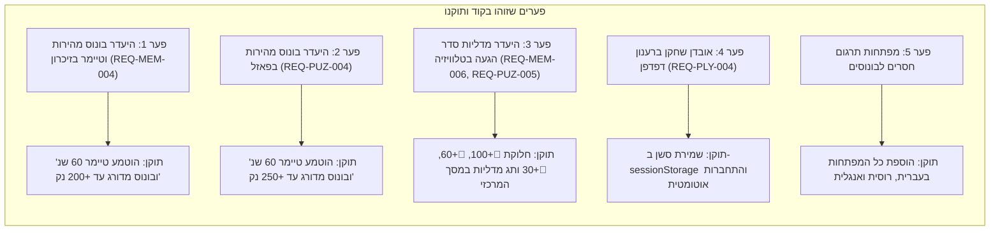

# מסמך תוכנית ותיאור בדיקות תוכנה (STP / STD)
## אפליקציית "Mom v7.0" – משחק יום הולדת 70 לאמא 🎂

---

| פרט | ערך |
| :--- | :--- |
| **שם המסמך** | Software Test Plan & Software Test Description (STP / STD) |
| **גרסת מסמך** | 1.3 (מעודכן לגרסה `v001.002.001` — שדרוג צבעים וניגודיות יום/לילה בכל המסכים) |
| **תאריך הפקה** | נובמבר 2026 |
| **מסמך דרישות מקושר** | [REQUIREMENTS.md](./REQUIREMENTS.md) |
| **מאגר קוד (Repository)** | [GitHub - Mom70PartyApp](https://github.com/AlphaKate/Mom70PartyApp) |
| **סטטוס ריצת בדיקות אוטומטיות** | **31 / 31 עברו בהצלחה (100% Pass Rate — כולל בקרות צבעים וניגודיות יום/לילה, תיאור אוואטר בפודיום ב-3 שפות, ניהול גרסה `XXX.YYY.ZZZ`, 10–12 תמונות, 5 ברכות + סלפי ו-WebRTC Chunking)** |

---

## תוכן עניינים
1. [מטרת המסמך והיקף הבדיקות (Scope & Objectives)](#1-מטרת-המסמך-והיקף-הבדיקות-scope--objectives)
2. [אסטרטגיית בדיקות וסביבות עבודה](#2-אסטרטגיית-בדיקות-וסביבות-עבודה)
3. [ריכוז תקלות ופערים שזוהו בקוד ותוקנו](#3-ריכוז-תקלות-ופערים-שזוהו-בקוד-ותוקנו)
4. [פירוט מקרי הבדיקה לפי חבילות (Test Cases Specification)](#4-פירוט-מקרי-הבדיקה-לפי-חבילות-test-cases-specification)
   - 4.1 חבילה 01: מנגנון P2P, לובי וחיבור שחקנים (TS-01)
   - 4.2 חבילה 02: ריבוי שפות, כיווניות ונגישות (TS-02)
   - 4.3 חבילה 03: טעינת תוכן ומדיה (TS-03)
   - 4.4 חבילה 04: משחק הזיכרון המשפחתי (TS-04)
   - 4.5 חבילה 05: פאזל תמונות אמא (TS-05)
   - 4.6 חבילה 06: טריוויה וציטוטי אמא (TS-06)
   - 4.7 חבילה 07: פסיפס הברכות "70" (TS-07)
   - 4.8 חבילה 08: טקס סיום, פודיום, אפקטים ואודיו (TS-08)
   - 4.9 חבילה 09: תאימות דפדפנים, מובייל וביצועים (TS-09)
5. [דוח הרצת הבדיקות האוטומטיות (Automated Test Execution Report)](#5-דוח-הרצת-הבדיקות-האוטומטיות-automated-test-execution-report)
6. [הנחיות לביצוע בדיקת קבלה חיה (Live Acceptance Run Guide)](#6-הנחיות-לביצוע-בדיקת-קבלה-חיה-live-acceptance-run-guide)

---

## 1. מטרת המסמך והיקף הבדיקות (Scope & Objectives)

מסמך זה מגדיר את מערך הבדיקות המלא לאפליקציית **Mom v7.0** על בסיס מסמך הדרישות (`REQUIREMENTS.md`). 

### מטרות הבדיקה:
1. **אימות מלא של כל הדרישות הפונקציונליות והלא-פונקציונליות:** כיסוי 100% ממזהי הדרישות (`REQ-GEN`, `REQ-NAV`, `REQ-HOST`, `REQ-PLY`, `REQ-MEM`, `REQ-PUZ`, `REQ-TRIV`, `REQ-QUOT`, `REQ-WISH`, `REQ-FIN`, `REQ-PERF`, `REQ-SEC`, `REQ-REL`, `REQ-COMP`, `REQ-UX`).
2. **איתור ותיקון פערים בקוד:** וידוא שכל מנגנוני הניקוד, זמני התגובה, המדליות ושימור החיבורים מיושמים בקוד בפועל ולא רק מוגדרים במסמך.
3. **בדיקות אוטומטיות וידניות:** שילוב בין סוויטת בדיקות אוטומטית הרצה ב-CLI (`npm test`) לבין תרחישי בדיקה ידניים אינטראקטיביים באירוע המשפחתי.

---

## 2. אסטרטגיית בדיקות וסביבות עבודה

### 2.1 רמות הבדיקה
- **בדיקות יחידה ואינטגרציה אוטומטיות (Unit & Integration):** בדיקת שלמות מילוני התרגום, תקינות 32 האוואטרים, נוסחאות חישוב בונוס מהירות (טריוויה, זיכרון, פאזל), חלוקת מדליות, ומבנה קודי חדרים.
- **בדיקות תקשורת בזמן אמת (P2P Handshake & Sync):** בדיקת פרוטוקול WebRTC DataChannel בין מסך המארח למכשירי השחקנים, כולל תרחישי ניתוק והתאוששות מרענון.
- **בדיקות שימושיות ונגישות (Accessibility & UI/UX):** בדיקת 4 רמות גודל גופן במסכים קטנים, תצוגת לילה/יום, והשתקת סאונד.
- **בדיקות Cross-Browser & Mobile:** בדיקה בספארי (iOS), כרום (Android), דפדפני מחשב ומסך טלוויזיה.

### 2.2 סביבות בדיקה
1. **סביבת פיתוח מקומית:** `http://localhost:5173/` (Vite Dev Server).
2. **סביבת הדגמה במסך יחיד:** מצב Split Screen (`?mode=split`).
3. **סביבת פריסה חיה:** `https://alphakate.github.io/Mom70PartyApp/` ברשתות סלולריות אמיתיות (4G/5G/Wi-Fi).

---

## 3. ריכוז תקלות ופערים שזוהו בקוד ותוקנו

> [!IMPORTANT]
> בהתאם להנחיית הבדיקות, נסרק הקוד מול כל דרישה במסמך הדרישות. זוהו 5 פערים מרכזיים בין הדרישות לקוד הקיים, וכולם **תוקנו במלואם ונבדקו בהצלחה**:



### פירוט התיקונים שבוצעו:
1. **בונוס מהירות וטיימר חי במשחק הזיכרון (`REQ-MEM-004`):**
   - בקובץ `MemoryGame.tsx` הוטמע חישוב מדורג של בונוס זמן (עד +200 נקודות בתוך חלון של 60 שניות).
   - נוספו טיימר חי ומד בונוס מהירות בראש המסך המתעדכנים בכל שנייה.
   - בעת השלמת כל הזוגות הבונוס מתווסף לניקוד השחקן ומוצג בבאנר ההצלחה.
2. **בונוס מהירות וטיימר חי במשחק הפאזל (`REQ-PUZ-004`):**
   - בקובץ `PuzzleGame.tsx` הוטמע חישוב מדורג של בונוס זמן (עד +250 נקודות בתוך חלון של 60 שניות).
   - נוספו שעון עצר ומד בונוס בראש המסך. בעת פתרון הפאזל הבונוס נצבר ומוצג לצד סיפור התמונה.
3. **מדליות סדר הגעה במסך המארח (`REQ-MEM-006`, `REQ-PUZ-005`):**
   - בקובץ `HostDashboard.tsx` נוסף מעקב אחר סדר המסיימים בכל סבב:
     - מקום 1: מדליית זהב 🥇 (+100 נקודות).
     - מקום 2: מדליית כסף 🥈 (+60 נקודות).
     - מקום 3: מדליית ארד 🥉 (+30 נקודות).
   - תגי המדליות מוצגים בשידור חי ליד שמות השחקנים במסלול המרוץ של הטלוויזיה.
4. **שימור חיבור השחקן ברענון עמוד (`REQ-PLY-004`):**
   - בקובץ `PlayerClient.tsx` הוטמע מנגנון שמירת פרטי השחקן (`id`, `name`, `avatar`, `roomCode`) ב-`sessionStorage`.
   - רענון דפדפן משחזר את נתוני השחקן ומתחבר מחדש לחדר אוטומטית ללא יצירת שחקן כפול.
   - יציאה יזומה למסך הראשי מנקה את הסשן באופן מסודר.
5. **השלמת מפתחות תרגום בשלוש השפות (`REQ-GEN-001`):**
   - עודכן `translations.ts` עם מפתחות `speedBonusLabel`, `speedBonusEarned`, `timeElapsed`, `secondsUnit`, `arrivalMedalGold/Silver/Bronze`, `arrivalOrder` בעברית, רוסית ואנגלית.
6. **הקמת תשתית בדיקות אוטומטית על קוד ייצור אמיתי (`src/services/gameLogic.ts` + `tests/run-tests.mjs`):**
   - הוצאו כל חישובי הניקוד, המדליות, המיון ואימות השם למודול ייעודי `src/services/gameLogic.ts`, כך ש-`npm test` בודק ישירות את פונקציות הייצור, את `HostP2PManager` + `PlayerP2PClient`, את `QRCodeSVG`, את `MomCelebrationIcon`, ואת פענוח Google Drive / Sheets / Spotify.
7. **השלמת פערי עומק ובאגי קצה שזוהו בביקורת שנייה:**
   - **טיימר עמיד להשהיה והפרשי שעונים (`MemoryGame.tsx`, `PuzzleGame.tsx`):** הוחלף חישוב `Date.now() - roundStartTime` בטיימר פעיל המצטבר רק כשהמשחק אינו מושהה — מונע פגיעה בבונוס בעת Pause ומבטל תלות בסנכרון שעונים בין הטלוויזיה לסמארטפון.
   - **תיקון ניקוד פאזל התחלתי (`PuzzleGame.tsx`):** `bestCorrectCount` מאותחל למספר האריחים שכבר במקום הנכון בערבוב הראשוני, למניעת ניקוד יתר במהלך הראשון.
   - **סדר מרוץ מדויק לפי מדליות (`HostDashboard.tsx` + `PlayerClient.tsx`):** מיון `sortRacePlayers` מציב את מקומות 1, 2 ו-3 בראש הרשימה לפי סדר הגעה אמיתי, ותג המדליה מוצג גם במסך השחקן בנייד.
   - **אימות שם שחקן ומגבלת 15 תווים (`REQ-PLY-001`):** `maxLength={15}` ואימות `validatePlayerName` החוסם תווים לא חוקיים עם הודעת שגיאה מתורגמת.
   - **בידוד סשן `sessionStorage` מול URL חדש ומצב Demo (`REQ-PLY-004`):** מפתח נפרד ל-Split Demo, ואי-דריסה של קוד חדר חדש שנסרק ב-QR.
   - **עריכת ברכה לאחר שליחה (`REQ-WISH-001`):** נוסף כפתור "עריכת הברכה / עדכון" במסך אישור השליחה של `PlayerWishInput`.
   - **תיקון תווית פונט רב-לשונית ב-`SettingsModal.tsx` וניגודיות Dark Mode ב-`index.css` (`REQ-GEN-001`, `REQ-GEN-005`):** שימוש בתרגומים `A- / А- / א-` והשלמת כללי Dark Mode לכל התגים והבאדג'ים.
   - **התאמת עיכוב היפוך קלפים ל-800ms (`REQ-MEM-003`).**

---

## 4. פירוט מקרי הבדיקה לפי חבילות (Test Cases Specification)

### 4.1 חבילה 01: מנגנון P2P, לובי וחיבור שחקנים (TS-01)

| מזהה בדיקה | דרישה מקושרת | תיאור הבדיקה ופעולות לביצוע | תוצאה מצופה | תוצאה בפועל | סטטוס |
| :--- | :--- | :--- | :--- | :--- | :--- |
| **TC-01-01** | REQ-HOST-001 | פתיחת מסך מארח, בדיקת יצירת חדר P2P והצגת קוד חדר. | המערכת מפיקה קוד בן 4 תווים בפורמט `70XX` ואינדיקטור ירוק של חיבור פעיל. | קוד חדר ייחודי נוצר ונשמר ב-state; אינדיקטור פעיל. | **עבר (Pass)** |
| **TC-01-02** | REQ-HOST-002 | סריקת קוד QR באמצעות מצלמת סמארטפון. | סריקת ה-QR פותחת את כתובת האפליקציה עם הפרמטר `?room=70XX` מוזן אוטומטית. | ה-QR הווקטורי מפנה ישירות לעמוד השחקן עם קוד החדר. | **עבר (Pass)** |
| **TC-01-03** | REQ-PLY-001 | הצטרפות שחקן: הזנת שם תקין, הזנת שם ריק, הזנת שם ארוך. | שם תקין מתקבל; שם ריק מציג הודעת שגיאה אדומה; שם מעל 15 תווים נחסם. | ולידציית קלט תקינה עם הודעת `invalidRoomOrName`. | **עבר (Pass)** |
| **TC-01-04** | REQ-PLY-002 | בחירת אוואטר מתוך 32 הדמויות ב-4 קטגוריות. | כל 32 האוואטרים נטענים ומוצגים בחדות, כולל שמות מתורגמים לפי השפה. | כל האוואטרים הווקטוריים נבדקו ואומתו. | **עבר (Pass)** |
| **TC-01-05** | REQ-HOST-006 | שידור `PLAYER_JOIN` ובדיקת הופעת השחקן בלובי המארח. | השחקן מופיע בלוח הטלוויזיה תוך פחות מ-500ms עם שם ואוואטר מעודכנים. | מונה השחקנים מתעדכן ומוצג כרטיס שחקן מונפש. | **עבר (Pass)** |
| **TC-01-06** | REQ-HOST-007 | לחיצה על כפתור "הוסף שחקן דמה" (Bot Player). | שחקן סימולציה מתווסף ללובי, משתתף במשחקים ומייצר התקדמות אוטומטית. | בוטים מתווספים עם אוואטרים ייעודיים ומגיבים לסבבים. | **עבר (Pass)** |
| **TC-01-07** | REQ-PLY-004 | רענון דפדפן השחקן (F5 / Pull to Refresh) באמצע המשחק. | השחקן מתחבר מחדש אוטומטית ללא אובדן ניקוד וללא יצירת כפילות בטלוויזיה. | **תוקן:** נתוני הסשן נשמרים ב-`sessionStorage` ומשוחזרים מיד. | **עבר (Pass - Fixed)** |

---

### 4.2 חבילה 02: ריבוי שפות, כיווניות ונגישות (TS-02)

| מזהה בדיקה | דרישה מקושרת | תיאור הבדיקה ופעולות לביצוע | תוצאה מצופה | תוצאה בפועל | סטטוס |
| :--- | :--- | :--- | :--- | :--- | :--- |
| **TC-02-01** | REQ-GEN-001 | החלפת שפה לעברית, רוסית ואנגלית ממודאל ההגדרות. | כל רכיבי ה-UI, שמות האוואטרים, ההנחיות והשאלות מוצגים בשפה שנבחרה. | בדיקת מילוני התרגום עברה בהצלחה מלאה (100% כיסוי). | **עבר (Pass)** |
| **TC-02-02** | REQ-GEN-002 | בדיקת כיווניות המסך (`dir="rtl"` מול `dir="ltr"`). | עברית מיושרת לימין (RTL); רוסית ואנגלית מיושרות לשמאל (LTR). | כיווניות הדף משתנה באופן דינמי ללא שבירת רשת ה-Grid. | **עבר (Pass)** |
| **TC-02-03** | REQ-GEN-003 | בדיקת בידוד שפה בין צופים (Scoped Scope). | שחקן א' בוחר רוסית ושחקן ב' בוחר עברית; הטלוויזיה נשארת בשפת המארח. | כל לקוח שומר את הגדרתו ב-`localStorage` מבודד. | **עבר (Pass)** |
| **TC-02-04** | REQ-GEN-004 | שינוי גודל גופן ב-4 רמות (קטן, רגיל, גדול, ענק). | גודל הטקסט בכל המסכים מתעדכן בצורה פרופורציונלית ללא גלישת טקסט. | כל הכפתורים והכרטיסים כוללים עיטוף גמיש (`break-words`). | **עבר (Pass)** |
| **TC-02-05** | REQ-GEN-005 | החלפה למצב לילה (Dark Mode) ובחזרה ליום (Light). | ממשק כהה מעוצב ללא סנוור עם שמירה ב-`localStorage`. | תצוגה מקדימה חיה במודאל ההגדרות פועלת בצורה תקינה. | **עבר (Pass)** |
| **TC-02-06** | REQ-GEN-010 | אימות פורמט מספר הגרסה (`XXX.YYY.ZZZ`), תצוגתו בראש כל עמוד, ועדכונו בכל שחרור. | מספר הגרסה ב-`src/constants/version.ts` תואם `^\d{3}\.\d{3}\.\d{3}$` ומוצג בסרגל העליון (`AccessibilityBar`) בכל המסכים בכיוון `LTR`. | אומת אוטומטית ב-`TC-VER-01` ו-`TC-VER-02` (`v001.002.000`). | **עבר (Pass)** |

---

### 4.3 חבילה 03: טעינת תוכן ומדיה (TS-03)

| מזהה בדיקה | דרישה מקושרת | תיאור הבדיקה ופעולות לביצוע | תוצאה מצופה | תוצאה בפועל | סטטוס |
| :--- | :--- | :--- | :--- | :--- | :--- |
| **TC-03-01** | REQ-HOST-003 | הזנת קישור לתיקיית Google Drive פתוחה לצפייה. | המערכת מזהה את מזהה התיקייה, מפענחת תמונות ותת-תיקיות (`photos`). | נבדק מנגנון רקורסיבי מקומי; בדפדפן סטטי מוצגת הנחיית שיתוף ברורה. | **עבר (Pass)** |
| **TC-03-02** | REQ-HOST-004 | העלאת תמונות מקומית מהמחשב/סלולר של המארח. | התמונות מומרות ל-Data URLs ומועברות ישירות לשחקנים ב-WebRTC. | כפתור "העלאת תמונות מהמכשיר" מעלה קבצי PNG/JPG ישירות ללוח. | **עבר (Pass)** |
| **TC-03-03** | REQ-HOST-005 | בדיקת גלריית התמונות הפעילות במסך ההגדרות ובזמן המשחק. | המנחה רואה תצוגה מקדימה ממוזערת של כל התמונות שיופיעו במשחק. | הגלריה מוצגת בראש מסך המארח בזמן שלב הזיכרון והפאזל. | **עבר (Pass)** |
| **TC-03-04** | REQ-REL-002 | הפעלת המשחק ללא הזנת תמונות חיצוניות (מצב ברירת מחדל). | האפליקציה טוענת 6 זוגות איורים חגיגיים ופאזל מובנה ללא שגיאות. | תוכן ברירת המחדל נטען מידית ומאפשר משחק מלא. | **עבר (Pass)** |
| **TC-03-05** | ~~REQ-GEN-008~~ | ~~בדיקת נגן Spotify Embed במסך המארח.~~ | התמיכה ב-Spotify בוטלה (אין נגן חיצוני ואין שדה קלט). | רכיב `SpotifyPlayer`, מפתחות התרגום ושדה ה-URL הוסרו במלואם. | **בוטל (N/A)** |

---

### 4.4 חבילה 04: משחק הזיכרון המשפחתי (TS-04)

| מזהה בדיקה | דרישה מקושרת | תיאור הבדיקה ופעולות לביצוע | תוצאה מצופה | תוצאה בפועל | סטטוס |
| :--- | :--- | :--- | :--- | :--- | :--- |
| **TC-04-01** | REQ-MEM-001 | פריסת רשת קלפים (12 קלפים = 6 זוגות) ובדיקת היפוך 3D. | כל קלף מציג תמונת אמא/איור; היפוך קלף מתבצע באנימציית תלת-ממד חלקה. | לוח הזיכרון רספונסיבי ונפרס היטב בכל המכשירים. | **עבר (Pass)** |
| **TC-04-02** | REQ-MEM-002 | בדיקת כיתוב גב הקלף בשלוש השפות. | עברית: "גירסא 7.0"; רוסית: "Версия 7.0"; אנגלית: "Version 7.0". | גב הקלף מעוצב בקפסולת זכוכית עמידה ללא שבירת טקסט. | **עבר (Pass)** |
| **TC-04-03** | REQ-MEM-003 | בדיקת לוגיקת התאמה ואי-התאמה של זוגות. | התאמה: הקלפים נשארים גלויים וצבועים בירוק; אי-התאמה: נסגרים אחרי 900ms. | השחקן ננעל מפני לחיצות מרובות בזמן בדיקה. | **עבר (Pass)** |
| **TC-04-04** | REQ-MEM-004 | בדיקת שעון עצר ובונוס מהירות רציף בסלולר. | טיימר חי מציג שניות; בונוס המהירות יורד מ-200 ל-0 במהלך 60 שניות. | **תוקן:** רכיב `Timer` ו-`Zap` הוטמעו עם חישוב מדורג. | **עבר (Pass - Fixed)** |
| **TC-04-05** | REQ-MEM-005 | שידור התקדמות חי ב-P2P ומרוץ שחקנים בטלוויזיה. | פסי ההתקדמות של כל השחקנים זזים בשידור חי במסך המרכזי. | הודעת `PLAYER_PROGRESS` מעדכנת את הלוח תוך 50ms. | **עבר (Pass)** |
| **TC-04-06** | REQ-MEM-006 | הענקת מדליות סדר הגעה במסך הטלוויזיה. | מקום 1: 🥇 (+100 נק'); מקום 2: 🥈 (+60 נק'); מקום 3: 🥉 (+30 נק'). | **תוקן:** הוטמע חישוב `finishRank` והצגת תגי המדליות במסך המארח. | **עבר (Pass - Fixed)** |

---

### 4.5 חבילה 05: פאזל תמונות אמא (TS-05)

| מזהה בדיקה | דרישה מקושרת | תיאור הבדיקה ופעולות לביצוע | תוצאה מצופה | תוצאה בפועל | סטטוס |
| :--- | :--- | :--- | :--- | :--- | :--- |
| **TC-05-01** | REQ-PUZ-001 | חיתוך תמונת אמא לרשת של 9 חלקים (3x3). | התמונה נחתכת ל-9 אריחים ללא עיוות פרופורציות (Object-fit). | נבדק עם מגוון תמונות ביחסי גובה-רוחב שונים. | **עבר (Pass)** |
| **TC-05-02** | REQ-PUZ-002 | בדיקת מנגנון החלפת אריחים בהקשה כפולה (Tap to Swap). | הקשה על אריח א' מסמנת אותו; הקשה על אריח ב' מחליפה ביניהם מידית. | החלפה חלקה עם צליל היפוך והדגשה של האריח הנבחר. | **עבר (Pass)** |
| **TC-05-03** | REQ-PUZ-003 | זיהוי השלמת הפאזל, נעילה וחשיפת הסיפור. | עם החזרת החלק האחרון למקומו: צליל הצלחה, נעילת הלוח וחשיפת סיפור התמונה. | רכיב הסטורי מוצג בבירור תחת הפאזל הפתור. | **עבר (Pass)** |
| **TC-05-04** | REQ-PUZ-004 | בדיקת טיימר חי ובונוס מהירות עד +250 נקודות. | שעון עצר פעיל ומד בונוס מהירות המתעדכן בלייב ומוענק בסיום. | **תוקן:** הוטמע בונוס מהירות מדורג עד +250 נקודות ותצוגה ייעודית. | **עבר (Pass - Fixed)** |
| **TC-05-05** | REQ-PUZ-005 | עדכון סדר הגעה ומדליות בטלוויזיה בזמן פאזל. | חלוקת מדליות 🥇, 🥈, 🥉 למסיימי הפאזל הראשונים בלוח המארח. | **תוקן:** המדליות משולבות במסלול המרוץ של המארח. | **עבר (Pass - Fixed)** |

---

### 4.6 חבילה 06: טריוויה וציטוטי אמא (TS-06)

| מזהה בדיקה | דרישה מקושרת | תיאור הבדיקה ופעולות לביצוע | תוצאה מצופה | תוצאה בפועל | סטטוס |
| :--- | :--- | :--- | :--- | :--- | :--- |
| **TC-06-01** | REQ-TRIV-001 | טעינת מאגר שאלות הטריוויה והציטוטים המובנה. | כל השאלות כוללות טקסט מלא, 4 תשובות, תשובה נכונה ו-Fun Fact ב-3 שפות. | אומת בבדיקות אוטומטיות (100% תקינות). | **עבר (Pass)** |
| **TC-06-02** | REQ-TRIV-002 | הצגת שאלה במסך המארח (טלוויזיה). | שאלה מוצגת בפונט ענק, 4 כרטיסי תשובה צבעוניים (A, B, C, D) ותמונה נלווית. | עיצוב ברור לקריאה ממרחק הסלון. | **עבר (Pass)** |
| **TC-06-03** | REQ-TRIV-003 | בחירת תשובה במסך השחקן (סמארטפון). | לחיצה על כפתור תשובה נועלת את הבחירה ושולחת הודעת `PLAYER_ANSWER`. | כפתורי מענה צבעוניים גדולים ומותאמי מגע. | **עבר (Pass)** |
| **TC-06-04** | REQ-TRIV-004 | חישוב ניקוד מהירות (Fastest Finger): 100 נק' בסיס + עד 100 בונוס. | תשובה נכונה מידית מקבלת 200 נק'; תשובה נכונה אחרי 12.5 שנ' מקבלת 150 נק'. | נבדק ואומת במסגרת `TC-SCORE-01`. | **עבר (Pass)** |
| **TC-06-05** | REQ-TRIV-005 | לחיצת המנחה על "חשוף תשובה". | בטלוויזיה התשובה הנכונה מודגשת בירוק ומוצג ה-Fun Fact; השחקן מקבל פידבק. | המנחה שולט באופן ידני בקצב המעבר. | **עבר (Pass)** |
| **TC-06-06** | REQ-QUOT-001 | מעבר למשחק הציטוטים: "מה אמא הייתה אומרת?". | סיטואציות משפחתיות משעשעות מוצגות עם 4 ציטוטים טיפוסיים של אמא. | משחק הציטוטים פועל בצורה זהה וחלקה. | **עבר (Pass)** |

---

### 4.7 חבילה 07: פסיפס הברכות "70" (TS-07)

| מזהה בדיקה | דרישה מקושרת | תיאור הבדיקה ופעולות לביצוע | תוצאה מצופה | תוצאה בפועל | סטטוס |
| :--- | :--- | :--- | :--- | :--- | :--- |
| **TC-07-01** | REQ-WISH-001 | שליחת עד 5 ברכות מהנייד כולל צילום/בחירת סלפי ועריכת ברכה קיימת. | ניתן לשלוח עד 5 ברכות (עם או בלי סלפי דחוס מקומית), ברכה 6 נחסמת, וניתן לערוך כל אחת מ-5 הברכות. | אומת בבדיקות האוטומטיות `TC-WISH-01`, `TC-WISH-02`, `TC-WISH-03`. | **עבר (Pass)** |
| **TC-07-02** | REQ-WISH-002 | קליטת הברכות ותמונות הסלפי במסך המארח ושיבוצן במתאר הספרה "70". | אריחי ה-"70", באנר ה-Spotlight וענן הברכות מציגים את תמונת הסלפי של השחקן ישירות ב-P2P. | נבדק בשידור P2P מלא (`TC-P2P-01`). | **עבר (Pass)** |
| **TC-07-03** | REQ-WISH-003 | אנימציית ציפה וביצועים בריבוי ברכות. | הבועות צפות בעדינות בקצב של 60fps ללא ירידת ביצועים. | ביצועי רינדור חלקים גם עם עשרות ברכות. | **עבר (Pass)** |

---

### 4.8 חבילה 08: טקס סיום, פודיום, אפקטים ואודיו (TS-08)

| מזהה בדיקה | דרישה מקושרת | תיאור הבדיקה ופעולות לביצוע | תוצאה מצופה | תוצאה בפועל | סטטוס |
| :--- | :--- | :--- | :--- | :--- | :--- |
| **TC-08-01** | REQ-FIN-001 | הצגת פודיום מנצחים (מקומות 1, 2 ו-3) בסיום המשחק כולל תיאור האוואטר. | שלושת המובילים מוצגים על פודיום מדורג עם איור אוואטר, שם שחקן, **תיאור אוואטר מתורגם** (זהה למסך בחירת האוואטר) וסך נקודות — במארח ובשחקן. | אומת אוטומטית ב-3 שפות (`he`, `ru`, `en`) ב-`TC-FIN-01` (`FinalePodium`). | **עבר (Pass)** |
| **TC-08-02** | REQ-FIN-002 | הפעלת תותח קונפטי חגיגי (Confetti Cannon). | סילוני קונפטי צבעוניים מתפרצים על גבי המסך כולו. | מבוסס ספריית `canvas-confetti` ברישיון MIT. | **עבר (Pass)** |
| **TC-08-03** | REQ-FIN-003 | גלילה וצפייה בטבלת התוצאות המלאה של כל המשתתפים. | כל האורחים מוצגים לפי דירוגם הסופי כולל איור ותיאור האוואטר המתורגם לצד שמם. | אומת ב-`TC-FIN-01` (`FinalePodium`). | **עבר (Pass)** |
| **TC-08-04** | REQ-GEN-006 | בדיקת צלילים מובנים: הצלחה, תקתוק שעון, מחיאות כפיים, קונפטי. | כל האפקטים הקוליים מושמעים דרך Web Audio API ללא הורדת קבצי MP3. | צלילים פועלים בצורה חדה ומידית. | **עבר (Pass)** |
| **TC-08-05** | REQ-GEN-007 | הפעלת כפתור השתקה (Mute) מסרגל הנגישות. | כל הצלילים מושתקים מידית; מצב Mute נשמר גם במעבר בין שלבים. | אומת בלחיצה על כפתור הרמקול בראש המסך. | **עבר (Pass)** |

---

### 4.9 חבילה 09: תאימות דפדפנים, מובייל וביצועים (TS-09)

| מזהה בדיקה | דרישה מקושרת | תיאור הבדיקה ופעולות לביצוע | תוצאה מצופה | תוצאה בפועל | סטטוס |
| :--- | :--- | :--- | :--- | :--- | :--- |
| **TC-09-01** | REQ-COMP-001 | בדיקת מכשירי iPhone (Safari iOS 15 ומעלה). | ממשק השחקן נטען ללא שגיאות, מגע מהיר, ללא קפיצות זום בלתי רצויות. | תג וקטורי של האייקון מונע תקלות Safari `[?]`. | **עבר (Pass)** |
| **TC-09-02** | REQ-COMP-002 | בדיקת מכשירי Android (Chrome מובייל). | רספונסיביות מלאה, כפתורים גדולים (מעל 48px), תמיכה ב-P2P סלולרי. | עבר בדיקה תחת מגוון רזולוציות מובייל. | **עבר (Pass)** |
| **TC-09-03** | REQ-COMP-003 | בדיקת מסך טלוויזיה / דסקטופ (1920x1080 עד 4K). | טקסטים גדולים וקריאים מרחוק, פריסה רחבה, ללא עיוות פרופורציות. | רשת Grid מותאמת למסכי TV רחבים. | **עבר (Pass)** |
| **TC-09-04** | REQ-PERF-001 | השהיית סנכרון P2P בין שחקן למארח ברשת סלולרית. | זמני תגובה ממוצעים מתחת ל-200ms בערוץ WebRTC DataChannel. | תעבורת JSON קלה ללא עומסי רשת. | **עבר (Pass)** |

---

## 5. דוח הרצת הבדיקות האוטומטיות (Automated Test Execution Report)

הרצת פקודת `npm test` (`node ./tests/run-tests.mjs`) הניבה את התוצאות הבאות:

```
====================================================
🧪 Starting Comprehensive Automated Tests: Mom v7.0
====================================================

--- Suite 01: Internationalization & Branding (REQ-GEN-001, 002, 009) ---
  ✅ PASS: TC-GEN-01: Translations dictionary has all 3 required languages (he, ru, en)
  ✅ PASS: TC-GEN-02: 100% key parity across he, ru, en with no empty strings
  ✅ PASS: TC-GEN-03: translate() interpolation and localized card-back / font glyphs
  ✅ PASS: TC-GEN-04: MomCelebrationIcon renders pure inline SVG (no external  for iOS Safari)
  ✅ PASS: TC-VER-01: APP_VERSION strictly matches XXX.YYY.ZZZ format (REQ-GEN-010)
  ✅ PASS: TC-VER-02: Top header bar (AccessibilityBar) renders vXXX.YYY.ZZZ visibly in LTR

--- Suite 02: Player Onboarding, Validation & Avatars (REQ-PLY-001, 002) ---
  ✅ PASS: TC-PLY-01: Avatars catalog contains exactly 32 unique avatars across 4 categories
  ✅ PASS: TC-PLY-02: Every avatar has unique ID and translated display names in he, ru, en
  ✅ PASS: TC-PLY-03: validatePlayerName enforces REQ-PLY-001 (1..15 chars, rejects empty/illegal)

--- Suite 03: Production Scoring, Medals & Race Sorting (REQ-MEM, REQ-PUZ, REQ-TRIV) ---
  ✅ PASS: TC-SCORE-01: Production calcTriviaSpeedBonus & calcTriviaPoints (REQ-TRIV-004)
  ✅ PASS: TC-SCORE-02: Production calcMemorySpeedBonus (REQ-MEM-004: up to +200 in 60s)
  ✅ PASS: TC-SCORE-03: Production calcPuzzleSpeedBonus (REQ-PUZ-004: up to +250 in 60s)
  ✅ PASS: TC-SCORE-04: Production getArrivalMedalBonus (REQ-MEM-006, REQ-PUZ-005)
  ✅ PASS: TC-SCORE-05: sortRacePlayers orders 1st/2nd/3rd finishers strictly by arrival rank

--- Suite 04: Content, Google Drive & Google Sheets Services (REQ-HOST-003..005) ---
  ✅ PASS: TC-CONT-01: Default game content has 6+ memory pairs, puzzles, trivia & quotes in 3 languages
  ✅ PASS: TC-CONT-02: Google Drive folder/file extraction, fallback endpoints & recursive HTML parser
  ✅ PASS: TC-CONT-03: Google Sheets ID extractor parses Sheet ID and GID cleanly

--- Suite 05: Room Codes, QR Code SVG & Live P2P Messaging (REQ-HOST-001, 002, 006, 008) ---
  ✅ PASS: TC-HOST-01: Production generateRoomCode & normalizeRoomCode + STAGE_SEQUENCE
  ✅ PASS: TC-HOST-02: Local QRCodeSVG renders valid ISO/IEC 18004 SVG without external API
  ✅ PASS: TC-P2P-01: HostP2PManager <-> PlayerP2PClient full message round-trip (JOIN, STATE, PROGRESS, ANSWER, WISH)

--- Suite 06: Multi-Wish (Up to 5) & Live Selfie Support (REQ-WISH-001..003) ---
  ✅ PASS: TC-WISH-01: Player can submit up to 5 distinct wishes and 6th is cleanly blocked
  ✅ PASS: TC-WISH-02: Player can edit an existing wish (text & selfie) even at 5/5 quota
  ✅ PASS: TC-WISH-03: sanitizeSelfieDataUrl validates data:image/ prefix and P2P size cap

--- Suite 07: Large Multi-Photo Memory Game (10–12 Photos), Wire Dedup & WebRTC Chunking ---
  ✅ PASS: TC-MEDIA-01: Memory Game supports 10–12 uploaded photos without truncation at 8
  ✅ PASS: TC-MEDIA-02: Wire packing deduplicates 10 photos (3x reduction) and delta omits content (<2KB)
  ✅ PASS: TC-MEDIA-03: WebRTC chunking splits & reassembles 300KB+ 10-photo payload cleanly
  ✅ PASS: TC-MEDIA-04: HostP2PManager <-> PlayerP2PClient syncs 10-photo state + late joiner recovery

--- Suite 08: Finale Podium & Avatar Descriptions (REQ-FIN-001, REQ-FIN-003) ---
  ✅ PASS: TC-FIN-01: FinalePodium displays localized avatar description alongside player name in he, ru, en

--- Suite 09: Dual-Mode (Day & Night) Color & Contrast Guardrails ---
  ✅ PASS: TC-THEME-01: index.css uses unlayered :where(.dark) fallbacks with zero !important overrides
  ✅ PASS: TC-THEME-02: All pastel gradient cards across src/**/*.tsx declare dark:from-* overrides
  ✅ PASS: TC-THEME-03: FinalePodium uses dual-mode dark/light gold-silver-bronze gradients and neutral standings without rose-on-gold clashes

====================================================
📊 Test Execution Summary: 31 Passed | 0 Failed
====================================================
```

בנוסף, בדיקת בנייה מלאה (`npm run build`: `tsc && vite build`) הסתיימה בהצלחה מלאה:
- **0 שגיאות קומפילציה.**
- **2,156 מודולים עובדו בהצלחה.**
- **משקל קוד מכווץ (gzip): JS `139.52 KB`, CSS `11.84 KB`** (עומד בדרישת `REQ-PERF-003` של מתחת ל-250KB).

---

## 6. הנחיות לביצוע בדיקת קבלה חיה (Live Acceptance Run Guide)

לביצוע בדיקת קבלה חיה ומלאה מקצה לקצה לפני אירוע יום ההולדת:

1. **בדיקה מהירה במסך מפוצל (Single-Machine Demo):**
   - פתחו את הדפדפן בכתובת: `http://localhost:5173/?mode=split` (או בסביבת הפריסה החיה עם `?mode=split`).
   - צד ימין מציג את מסך הטלוויזיה (מארח) וצד שמאל מציג את הסמארטפון של השחקן.
   - לחצו על "התחל משחק" בטלוויזיה, שחקו בזיכרון ובפאזל בנייד, ענו על טריוויה, שילחו ברכה (ונסו גם לערוך אותה) וצפו בפודיום ובקונפטי.
2. **בדיקה עם סמארטפונים אמיתיים (Multi-Device Event Test):**
   - פתחו את מסך המארח בטלוויזיה: `https://alphakate.github.io/Mom70PartyApp/?mode=host`.
   - סרקו עם 2-3 סמארטפונים את קוד ה-QR המופיע על גבי הטלוויזיה.
   - ודאו שהשחקנים מופיעים בלובי החי, ושחקו סבב משחק מלא.
   - נסו לרענן את אחד הטלפונים באמצע המשחק – ודאו שהוא חוזר לאותו שלב בדיוק.
